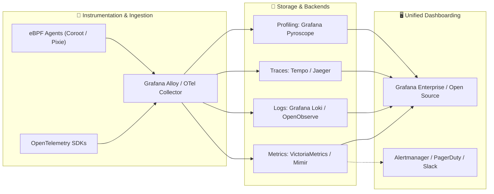

  

# 🚀 Awesome Managed Observability & Dashboards

  
  
  
  
  
  
  

---

## 🧭 Top Managed Observability, APM & Dashboards Tools Ecosystem

> **A curated discovery list of enterprise SaaS platforms and top open-source telemetry tools**  
> *Covering full-stack metrics visualization, log management, distributed tracing, OpenTelemetry backends, eBPF profiling, and cloud-native dashboard systems.*  
> **Last updated: March 2026**

This repository provides an authoritative, SEO-optimized comparison matrix of **enterprise SaaS platforms** and leading **open-source GitHub projects** across the **Managed Observability, APM, and Telemetry Dashboard** landscape. Whether you are managing Kubernetes microservices, multi-cloud enterprise workloads, or edge infrastructure, find the best tools to ingest, analyze, alert on, and correlate the three core pillars of observability (metrics, logs, traces) alongside continuous profiling and eBPF instrumentation.

---

## 📑 Table of Contents
- [📊 Sector Overview & Market Dynamics](#-sector-overview--market-dynamics)
- [☁️ SaaS & Hosted Platforms](#️-saas--hosted-platforms)
- [🔓 Open-Source GitHub Projects](#-open-source-github-projects)
- [🤝 How to Contribute](#-how-to-contribute)
- [💖 Support](#-support)
- [⭐ Star History](#-star-history)
- [⚖️ Disclaimer](#️-disclaimer)

---

## 📊 Sector Overview & Market Dynamics

The global cloud observability and Application Performance Monitoring (APM) market is estimated at **$12.5B to $13.5B in 2026**, on pace to surpass **$30B+ by 2032 at a CAGR of ~14–15%**. The sector exhibits a **concentrated top-tier oligopoly** dominated by enterprise giants like Datadog, Dynatrace, Cisco/Splunk, and Elastic capturing the majority of Fortune 500 spend, contrasted against a **moderately fragmented, highly vibrant long-tail** of high-cardinality point-solutions, AI-native platforms, and OpenTelemetry-native open-source frameworks.

---

## ☁️ SaaS & Hosted Platforms

The table below catalogs premier hosted observability vendors, sorted descending by enterprise scale (market capitalization, private valuation, or buyout value).

| 🏢 Platform | 💰 Scale (Valuation / Revenue) | 🏷️ Specific Starting Pricing | 🎁 Free Tier / Free Trial Limits | 🔍 Core Capabilities |
| :--- | :--- | :--- | :--- | :--- |
| **[Amazon Managed Grafana](https://aws.amazon.com/grafana/)** | **~$1.9T+ Market Cap** (AWS / Amazon) | **$9/active editor user/month** ($5/active viewer user/month) | **90-day free trial** with up to 5 free active users per AWS account | Fully managed and secure Grafana visualization for multi-source AWS & hybrid telemetry with built-in AWS IAM and SSO governance. |
| **[Datadog](https://www.datadoghq.com/)** | **~$98B Market Cap** (~$4.0B ARR) | **$15/host/month** (Infrastructure Pro, billed annually); APM from **$31/host/month** | **Free tier permanently**: Up to 5 hosts (core dashboards, 1-day metric retention); plus 14-day full free trial | Unified infrastructure, APM, log management, synthetic monitoring, and cloud SIEM with over 700+ turnkey integrations. |
| **[Dynatrace](https://www.dynatrace.com/)** | **~$18B Market Cap** (~$2.1B ARR) | **$21/month** (Infra for 8 GiB host, billed annually) or **$69/month** (Full-Stack APM 8 GiB host) | **14-day free trial** with full platform access (no permanent free tier) | Enterprise AI-powered observability (Davis AI) delivering automated discovery, end-to-end distributed tracing, and root-cause analysis. |
| **[Elastic Cloud](https://www.elastic.co/cloud)** | **~$10.3B Market Cap** (~$1.8B ARR) | **$99/month** (Standard hosted cluster tier) or serverless consumption ingest rates | **14-day free trial** of hosted cluster (~8 GB RAM / 240 GB storage); free forever if self-managed Basic license | Managed Elasticsearch and Kibana search, log analytics, APM, and unified vector search observability across AWS, GCP, and Azure. |
| **[New Relic](https://newrelic.com/)** | **$6.5B Valuation** (Francisco Partners buyout; ~$925M ARR) | **$0.30/GB** beyond free ingest allowance + **$49/month** per Core user | **Free forever**: **100 GB/month data ingest** across all data types and 1 free Full-Platform user with unlimited basic users | All-in-one observability platform featuring native APM, distributed tracing, Kubernetes cluster explorer, and AI assistance (New Relic Grok). |
| **[Grafana Cloud](https://grafana.com/)** | **$6.0B Valuation** (~$400M+ ARR) | **$19/month** (Grafana Cloud Pro platform fee + usage overages) | **Free forever**: **10,000 active metrics series**, **50 GB logs**, **50 GB traces**, 14-day retention, up to 3 users | Fully managed Grafana, Mimir (metrics), Loki (logs), Tempo (traces), and Pyroscope (profiling) stack with integrated AI assistant. |
| **[Chronosphere](https://chronosphere.io/)** | **$3.35B Acquisition** (Palo Alto Networks; ~$160M ARR) | **Enterprise contract** based on persisted datapoints per second (DPPS) | **Proof of Concept (PoC) / sales-led enterprise trial** (custom scope, typically 30 days) | Cloud-native observability platform equipped with Telemetry Control Plane to shape, transform, and curtail high-cardinality OpenTelemetry data. |
| **[Sumo Logic](https://www.sumologic.com/)** | **$1.7B Valuation** (Francisco Partners buyout; ~$300M ARR) | **~$90/month** (Essentials tier credit bundle) | **Free tier permanently**: Daily allocation of **~500 MB/day** data volume with 7-day log retention and up to 3 users | Cloud-native log analytics, SIEM security intelligence, and infrastructure observability powered by Cloud Flex credit economics. |
| **[Coralogix](https://coralogix.com/)** | **$1.6B Valuation** (~$180M ARR) | **$0.05/GB** metrics, **$0.16/GB** traces, **$0.17/GB** logs (consumption-based CXUs) | **Free tier permanently**: **5 GB total data/month** across metrics, logs, and traces with unlimited user seats | In-stream data lake observability architecture providing stateful real-time analytics, remote querying, and unconstrained cardinality. |
| **[Honeycomb](https://www.honeycomb.io/)** | **~$480M Valuation** (~$45M+ ARR) | **$130/month** (Pro plan base tier covering 100M events/month) | **Free forever**: **20 million events/month**, **100M metric points/month**, 60-day retention, unlimited seats & queries | High-cardinality exploratory APM and distributed tracing engine built specifically for deep OpenTelemetry debugging and bubble-up analysis. |

---

## 🔓 Open-Source GitHub Projects

The following self-hosted and community-driven projects are sorted descending by their official GitHub stargazer counts. Each entry includes a live social star badge linking to the repository's stargazers.

| 📦 Repository & Project | ⭐ GitHub Stars | ⚖️ License | 📝 Overview & Core Tech Stack |
| :--- | :--- | :--- | :--- |
| **[Uptime Kuma](https://github.com/louislam/uptime-kuma)** |  | `MIT` | Self-hosted uptime monitoring service featuring customizable dashboards, status pages, certificate tracking, and multi-channel notifications. |
| **[Netdata](https://github.com/netdata/netdata)** |  | `GPL-3.0` | Ultra-fast, real-time performance and health monitoring agent collecting per-second system, container, and application metrics. |
| **[Grafana](https://github.com/grafana/grafana)** |  | `AGPL-3.0` | The open-source standard for metric visualization, dynamic multi-tenant dashboards, alerting, and telemetry data exploration. |
| **[Prometheus](https://github.com/prometheus/prometheus)** |  | `Apache-2.0` | Cloud Native Computing Foundation (CNCF) monitoring system and time-series database with dimensional data models and PromQL. |
| **[SigNoz](https://github.com/SigNoz/signoz)** |  | `MIT` | Open-source alternative to Datadog natively powered by OpenTelemetry and ClickHouse for traces, metrics, and logs in a unified UI. |
| **[Grafana Loki](https://github.com/grafana/loki)** |  | `AGPL-3.0` | Horizontally scalable, highly available multi-tenant log aggregation system indexing only metadata labels (LogQL). |
| **[Apache SkyWalking](https://github.com/apache/skywalking)** |  | `Apache-2.0` | Distributed APM, tracing system, and observability analysis platform tailored for microservices, cloud-native, and container stacks. |
| **[Jaeger](https://github.com/jaegertracing/jaeger)** |  | `Apache-2.0` | CNCF distributed tracing backend for tracking transactions, root-cause troubleshooting, latency tuning, and dependency mapping. |
| **[Vector](https://github.com/vectordotdev/vector)** |  | `MPL-2.0` | High-performance, memory-safe observability data router and pipeline built in Rust for transforming logs, metrics, and event streams. |
| **[OpenObserve](https://github.com/openobserve/openobserve)** |  | `AGPL-3.0` | Cloud-native, high-efficiency observability database built in Rust for petabyte-scale logs, metrics, and traces with SQL support. |
| **[cAdvisor](https://github.com/google/cadvisor)** |  | `Apache-2.0` | Container resource usage and performance analysis tool providing real-time data for running containers and Kubernetes nodes. |
| **[Telegraf](https://github.com/influxdata/telegraf)** |  | `MIT` | Plugin-driven server agent by InfluxData for collecting, processing, aggregating, and writing metrics, logs, and sensor telemetry. |
| **[VictoriaMetrics](https://github.com/VictoriaMetrics/VictoriaMetrics)** |  | `Apache-2.0` | Ultra-fast, cost-effective time-series database and Prometheus drop-in alternative offering extreme compression and PromQL support. |
| **[Logstash](https://github.com/elastic/logstash)** |  | `SSPL-1.0` | Server-side data processing pipeline that ingests data from a multitude of sources simultaneously, transforms it, and ships to Elasticsearch. |
| **[Thanos](https://github.com/thanos-io/thanos)** |  | `Apache-2.0` | Highly available metric system with unlimited storage capacity and global query view for vanilla Prometheus deployments. |
| **[Pinpoint](https://github.com/pinpoint-apm/pinpoint)** |  | `Apache-2.0` | APM tool for large-scale distributed systems, tracing transactions across distributed applications with zero code modification. |
| **[Node Exporter](https://github.com/prometheus/node_exporter)** |  | `Apache-2.0` | Prometheus official exporter for hardware and OS metrics exposed by *NIX kernels, providing CPU, disk, memory, and network statistics. |
| **[Fluentd](https://github.com/fluent/fluentd)** |  | `Apache-2.0` | CNCF-graduated unified logging layer allowing unified data collection and consumption for a better use and understanding of data. |
| **[Kubeshark](https://github.com/kubeshark/kubeshark)** |  | `Apache-2.0` | The API traffic viewer for Kubernetes: deep packet inspection and network observability powered by eBPF with TLS decryption. |
| **[Grafana Pyroscope](https://github.com/grafana/pyroscope)** |  | `AGPL-3.0` | Continuous profiling platform for identifying CPU, memory, and lock contention down to source line numbers across microservices. |
| **[HyperDX](https://github.com/hyperdxio/hyperdx)** |  | `MIT` | Developer-first observability platform uniting session replay, logs, metrics, distributed traces, and frontend exceptions. |
| **[Prometheus Alertmanager](https://github.com/prometheus/alertmanager)** |  | `Apache-2.0` | Alert router and deduplication engine handling alerts sent by client applications such as the Prometheus server. |
| **[Fluent Bit](https://github.com/fluent/fluent-bit)** |  | `Apache-2.0` | Fast, lightweight, and highly scalable telemetry processor and log forwarder engineered for resource-constrained Linux and Kubernetes. |
| **[Coroot](https://github.com/coroot/coroot)** |  | `Apache-2.0` | eBPF-driven automated APM and root-cause analysis platform that discovers architecture topology and monitors application health. |
| **[OpenTelemetry Collector](https://github.com/open-telemetry/opentelemetry-collector)** |  | `Apache-2.0` | Vendor-agnostic telemetry proxy for receiving, processing, batching, and exporting OpenTelemetry traces, metrics, and logs. |
| **[OpenCost](https://github.com/opencost/opencost)** |  | `Apache-2.0` | Vendor-neutral, CNCF-sandbox real-time Kubernetes cost monitoring and cloud spend allocation specification and implementation. |
| **[GreptimeDB](https://github.com/GreptimeTeam/greptimedb)** |  | `Apache-2.0` | Open-source, cloud-native distributed time-series database optimized for metrics, events, and logs with PromQL and SQL support. |
| **[Pixie](https://github.com/pixie-io/pixie)** |  | `Apache-2.0` | CNCF open-source Kubernetes-native observability tool providing no-instrumentation auto-telemetry via kernel eBPF modules. |
| **[Zabbix](https://github.com/zabbix/zabbix)** |  | `AGPL-3.0` | Mature enterprise-class open-source monitoring software for networks, bare metal, virtual machines, and cloud services. |
| **[Cortex](https://github.com/cortexproject/cortex)** |  | `Apache-2.0` | Horizontally scalable, highly available, multi-tenant long-term storage backend for Prometheus metrics. |
| **[Grafana Tempo](https://github.com/grafana/tempo)** |  | `AGPL-3.0` | High-volume, cost-efficient distributed tracing backend needing only object storage to function, integrated tightly with Grafana. |
| **[Parca](https://github.com/parca-dev/parca)** |  | `Apache-2.0` | Continuous profiling platform analyzing CPU, memory, and goroutine performance down to exact source code lines using eBPF. |
| **[Uptrace](https://github.com/uptrace/uptrace)** |  | `AGPL-3.0` | Open-source APM tool for OpenTelemetry metrics, traces, and logs backed by ClickHouse and PostgreSQL for high throughput. |
| **[Grafana Alloy](https://github.com/grafana/alloy)** |  | `Apache-2.0` | Grafana's vendor-neutral OpenTelemetry Collector distribution with built-in Prometheus pipeline, components, and live debugging UI. |
| **[Tianji](https://github.com/msgbyte/tianji)** |  | `Apache-2.0` | All-in-one website telemetry combining traffic analytics, server status dashboards, and uptime monitoring in a single binary. |
| **[Wachd](https://github.com/wachd/wachd)** |  | `Apache-2.0` | Air-gapped, self-hosted AI-powered root cause analysis engine designed to triage alert storms for on-call engineers. |

---

## 🏗️ Architecture Blueprint: The Ideal Open-Source Telemetry Stack

If you are architecting a production-grade, self-hosted observability ecosystem without vendor lock-in, modern engineering teams recommend the following synergy:

---

## 🤝 How to Contribute

We love contributions! Follow these steps to submit a new observability platform or open-source tool:

1. 🍴 **Fork the repository** to your GitHub account.
2. 🌿 **Create a new branch** (`git checkout -b add-my-telemetry-tool`).
3. 📝 **Add or update the tool entry** in `README.md` following the established table structure.
   - For SaaS tools: include verified starting price, free tier/trial limits, and enterprise valuation.
   - For open-source tools: include official GitHub repo link and ensure the star badge uses `style=social&color=white`.
4. 💡 **Submit a Pull Request (PR)** with a concise rationale and documentation citation.

---

## 💖 Support

If you found **Awesome-Managed-Observability-Dashboards** helpful for evaluating vendors or building your platform stack:

- ⭐ **Star this repository** to help others discover it!
- 🍴 **Fork and share** with your DevOps, SRE, and platform engineering teams.
- ☕ **Sponsor the maintainer** or buy a coffee via the official [Sponsor Dashboard](https://github.com/sponsors/ishandutta2007).

---

## ⭐ Star History

---

## ⚖️ Disclaimer

- This repository is a **community-curated index** created for informational, benchmarking, and architectural evaluation purposes.
- Product logos, trademarks, and registered brands belong to their respective corporate owners.
- Observability and telemetry pipelines process sensitive operational data; ensure your architectures maintain compliance with GDPR, CCPA, SOC 2, HIPAA, and relevant telemetry retention standards.
